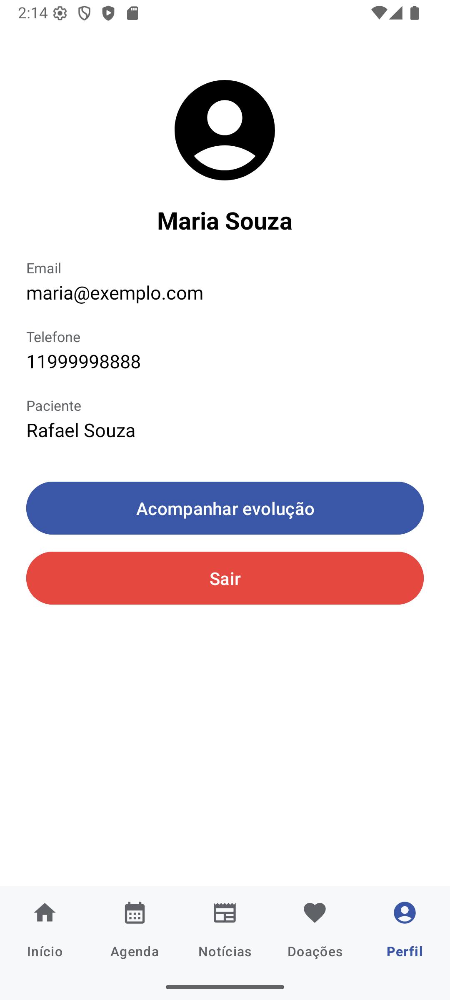
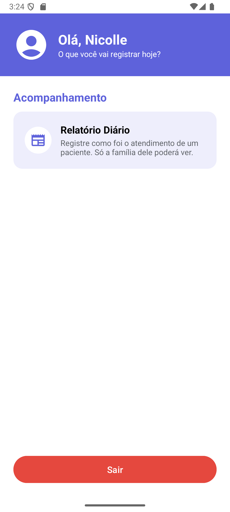

<div align="center">


# App Bem Me Quer

**O aplicativo que aproxima as famílias atendidas e a equipe do Centro de Desenvolvimento Bem Me Quer.**

[](https://github.com/PedroXavierSantos/ONGBemMeQuer/actions/workflows/ci.yml)


</div>

---

## Sobre

O Bem Me Quer é uma ONG que oferece fisioterapia, pedagogia, psicologia, artes e terapia assistida por animais
para crianças. Este app digitaliza o dia a dia dela:

- **Famílias** acompanham a evolução do filho pelos relatórios da equipe, conhecem os serviços e apoiam a ONG.
- **Funcionários** registram os atendimentos e, em breve, a agenda e o ponto.

Cada família vê **somente** os dados do próprio filho: a segurança é garantida no servidor, pelas
[regras do Firestore](firebase/firestore.rules), e não apenas pelo app.

## Telas

<div align="center">

| Início | Perfil | Funcionário | Acompanhamento |
| :---: | :---: | :---: | :---: |
|  |  |  |  |

<sub>Capturas com dados fictícios do ambiente de testes.</sub>

</div>

## Funcionalidades

| Funcionalidade | Para quem | Status |
| --- | --- | --- |
| Cadastro e login com e-mail e senha | Famílias e equipe | ✅ Pronto |
| Abas Início (serviços) e Perfil | Famílias | ✅ Pronto |
| Relatório diário do atendimento | Equipe escreve, família lê | ✅ Pronto |
| Agenda de atendimentos | Famílias e equipe | 🚧 Em desenvolvimento |
| Notícias e doações | Famílias | 🚧 Em desenvolvimento |
| Ponto com localização e selfie | Equipe | 📋 Planejado |
| Campanhas sazonais (Páscoa, Natal) | Famílias | 📋 Planejado |

## Tecnologias

- **App:** Java 11, Android SDK 35 (mínimo Android 8.0), Material Design 3
- **Back-end:** Firebase Authentication e Cloud Firestore (São Paulo)
- **Build:** Gradle 8.14 com Android Gradle Plugin 8.9
- **Qualidade:** GitHub Actions (build, testes e testes das regras de segurança a cada Pull Request)

## Como rodar

**Pré-requisitos:** Android Studio, JDK 17 ou mais novo e, para os testes das regras, Node.js 20 ou mais novo.

1. Clone o repositório e abra a pasta no Android Studio.
2. Coloque os arquivos de configuração do Firebase (eles não ficam no Git). Peça ao mantenedor ou baixe no console:
   - `app/src/debug/google-services.json`: projeto de **testes** (`bemmequer-dev`), usado pelo ▶️ Run
   - `app/google-services.json`: projeto **real**, usado só no build de entrega
3. Clique em ▶️ **Run**.

Testes:

```bash
./gradlew testDebugUnitTest lintDebug
```

```bash
cd firebase && npm install && npm run test:regras
```

## Estrutura

```
app/src/main/java/com/app/bemmequer/
├── auth/      login e cadastro (Firebase Authentication)
├── data/      acesso ao Firestore (usuários e relatórios)
└── ui/        telas: login, cadastro, paciente/ e funcionario/
firebase/      regras de segurança, índices e seus testes
docs/          documentação técnica e decisões de arquitetura
```

## Documentação

- [Como contribuir](CONTRIBUTING.md): branches, commits e Pull Requests
- [Firebase](docs/FIREBASE.md): ambientes, regras, comandos e contas de funcionário
- [Decisões de arquitetura](docs/decisoes/README.md): o porquê das principais escolhas do projeto

---

<div align="center">

Desenvolvido por [Pedro Xavier Santos](https://github.com/PedroXavierSantos) para o **Centro de Desenvolvimento Bem Me Quer**.

</div>
